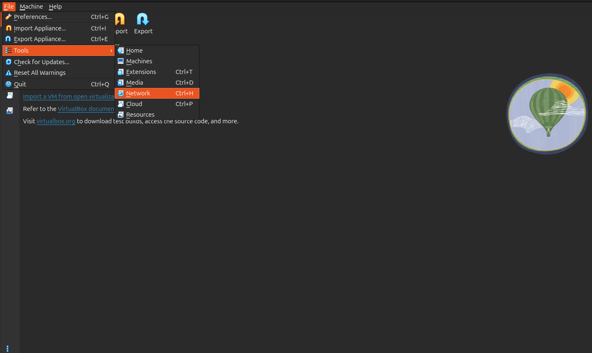
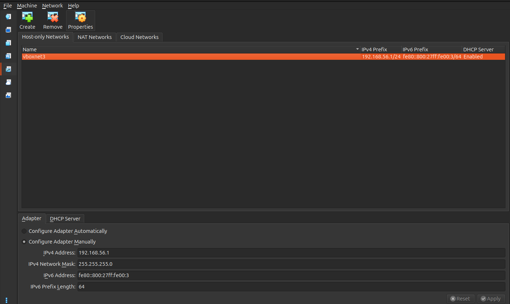
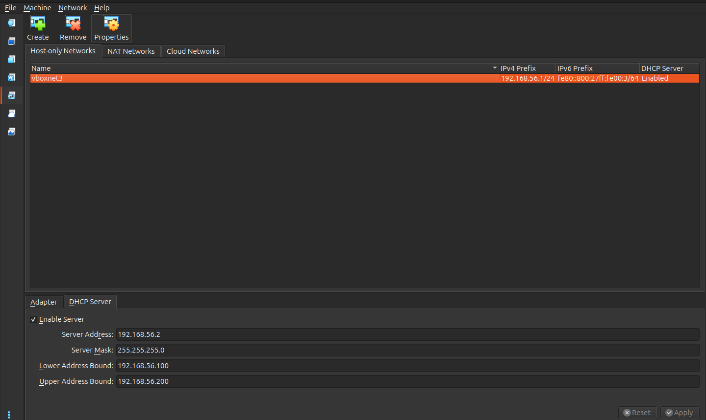
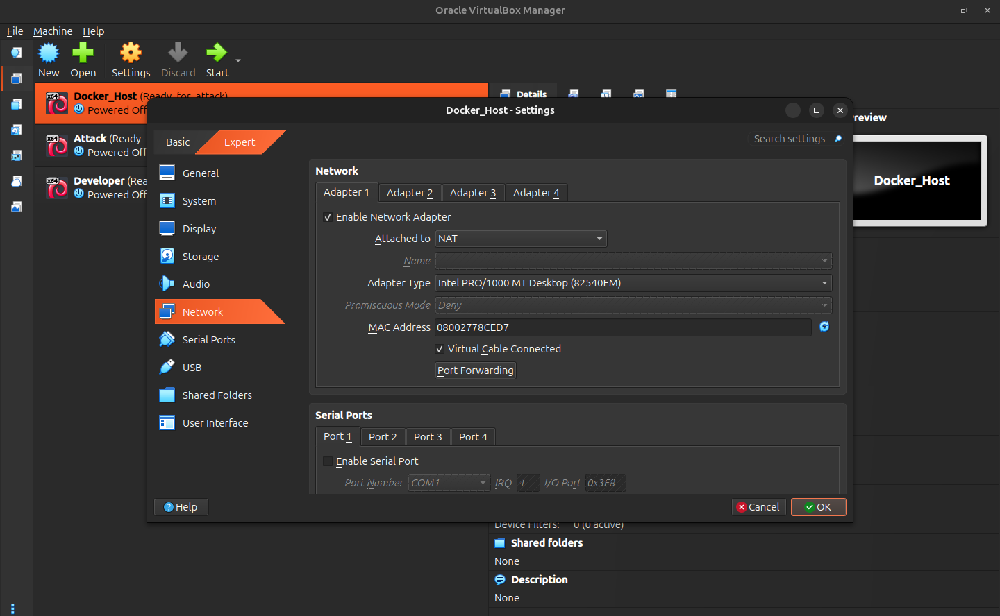
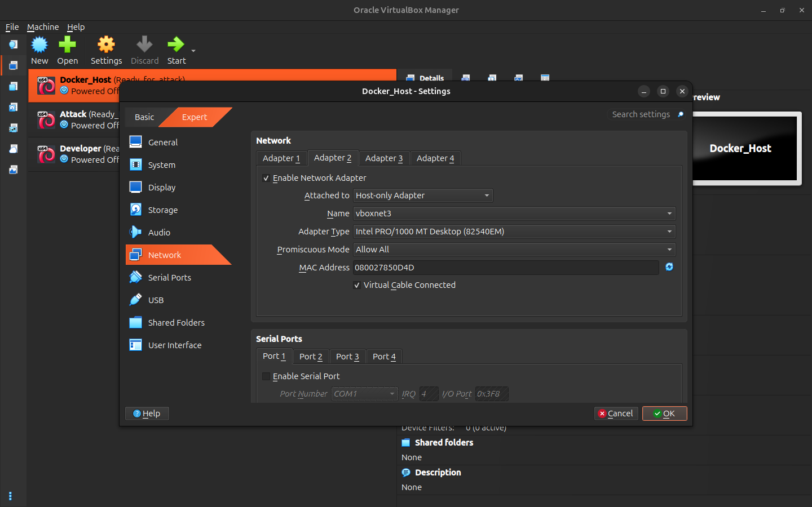

# Mamy 3 maszynki
Każda z nich powinna mieć dostęp do internetu przez NAT oraz powinny być połączone ze sobą przez wirtualny adapter, adresy powinny byc przydzielane dynamicznie. Na dole załączam zdjęcia jak to powinno wyglądać. Każda maszyna ma przewidziane ok 19gb na dane. Genralnie na potrzeby projektu powinno starczyc. 
 
## Docker_Host
	login="docker_host"
	hasło="super_secret"

W home powienien byc folder pcyb. Tam jest całe środowistko. 
Jak wpiszecie `docker ps`, to pokażą wam się odpalone kontenery. Jeśli jakimś trafem się nie odpaliły, to wchodzicie do `pcyb/sklep_webapp` i wpisujecie `docker compose up -d`

### Generalnie są tam postawione 4 kontenerki
	vector - Nasz podatny kontener, przy okazji bedzie mozna go wykorzystac w II etapie. Wiąże się to z fajnym narzędziem do wizualizacji logów. Jest tam też serwer telnet wystawiony na porcie 2323. Login i hasło tj do konta Developera.

	backend - spring boot, jak sama nazwa wskazuje backend aplikacji
	
	web - serwer http
	
	mysql - baza danych

## Developer
	login="dev"
	hasło="super_secret"

## Attack
	login="anonymous"
	hasło="super_secret"
Zainstalowałem nmapa, aby "atakujący" przeskanował sieć. Można tam wyczytać dostępne urządzenia i porty.

## Konfiguracja sieci
### Wchodzimy w File > Tools > Network

---

### Jeśli lista jest pusta dodajemy nowy adapter
	Adres_IP:   	192.168.56.1
	Maska: 			255.255.255.0 
	IPv6:       	nie ma takiego znaczenia

---

### Następnie konfigurujemy Server DHCP
	Adres Serwera:	192.168.56.2
	Maska			255.255.255.0
	Dolny zakres:	192.168.56.100
	Górny zakres:	192.168.56.254 

---

### Każda maszyna ma również dwie wirtualne karty sieciowe

#### NAT

#### Host-only

